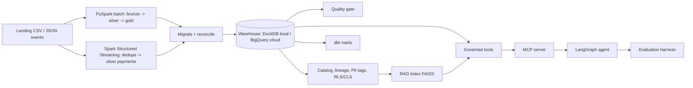

# LakehouseBridge

A governed lakehouse-to-warehouse migration with a data-connected AI agent.

PySpark builds a bronze/silver/gold lakehouse (batch + structured streaming) -> tables are migrated to a
warehouse with row/column reconciliation -> a quality gate, catalog, lineage, PII tagging and row/column security
protect the data -> dbt builds marts -> a LangGraph agent answers questions through MCP tools, with RAG over the
catalog, and is evaluated against ground truth.

All data is synthetic.



## Quick start

```bash
pip install -r requirements.txt        # needs Java 17+ for PySpark
make all                               # ~1 min: data -> spark -> migrate -> quality -> govern -> dbt -> agent eval
make test                              # 20 tests (set LB_SCALE=0.1 for speed)
LB_ROLE=analyst_apac python -m lakehouse_bridge.agent.graph "How many customers do we have?"
```

## What was run (full-scale local run, see docs/sample_run/)

| Stage | Result |
|---|---|
| Batch | 20,100 bronze orders -> 100 duplicates removed, 398 quarantined (non-positive amount / orphan customer), 19,602 silver |
| Streaming | 10,100 events incl. replays -> 10,000 unique silver payments; re-run processes nothing new (checkpoint) |
| Migration | 7 tables, 11-20 profile checks each (row count, null counts, sums, min/max, distinct keys): all reconcile |
| Quality gate | 14 / 14 rules pass; test proves the gate fails on duplicates, negative amounts and invalid values |
| Governance | `analyst_apac` sees only APAC rows with masked name/email/phone; restricted table hidden |
| dbt | 3 models + 9 tests, 12 / 12 pass (DuckDB) |
| Agent evaluation | 14 questions + 8 safety cases, all pass (3 questions through a real MCP stdio session) |

## Requirement coverage and honest status

Legend: **Done** = executed and tested here. **Written** = code provided, **not run** (needs GCP/Databricks).
**No** = not covered.

| Requirement (Google Data Engineer JD) | Where | Status |
|---|---|---|
| Python, SQL, PySpark pipelines | `pipelines/batch.py` (window fns, NTILE, DENSE_RANK) | Done |
| Batch and streaming | `pipelines/streaming.py` (Structured Streaming, watermark dedupe, checkpoint) | Done (local Spark) |
| Distributed production pipelines | Spark `local[2]` here; `scripts/submit_dataproc.sh` for Dataproc Serverless | Written |
| Data lake / lakehouse | Medallion layout on Parquet; Delta via `LB_FORMAT=delta` | Parquet Done / Delta Written |
| Databricks | Not used. Delta code path is Databricks-compatible only in principle | No |
| Cloud data warehouse (BigQuery) | `migrate_bigquery()`, `dbt` bigquery profile, generated BigQuery DDL | Written |
| Migration with validation | `migration/migrate.py` reconciliation. Source is a simulated Parquet lakehouse, **not** a real Databricks/Snowflake/Oracle | Done (simulated source) |
| Catalog, lineage, glossary, PII tagging | `governance/catalog.py` (own implementation, **not** Dataplex / Unity Catalog / Collibra) | Done |
| Data quality | `governance/quality.py` + `governance/rules.yaml` | Done |
| Row/column-level security | `governance/security.py` (per-role physical DBs locally; BigQuery DDL generated) | Local Done / BigQuery Written |
| RAG + vector embeddings | `agent/rag.py` FAISS; default embedder is hashed n-grams (lexical); `EMBEDDER=vertex` path | Done (lexical) / Vertex Written |
| Agent frameworks: LangGraph, MCP | `agent/graph.py`, `agent/mcp_server.py` | Done |
| Google ADK / Vertex AI agents | Not used | No |
| Build and evaluate tool-using agents on enterprise data | `agent/eval.py` | Done (baseline planner, see limits) |
| Orchestration (Airflow / Composer) | `dags/lakehouse_bridge_dag.py` | Written (static test only) |
| dbt | `dbt_project/` | Done (DuckDB) |
| Dataform, Looker, Iceberg | | No |
| Google Cloud Platform | `scripts/gcp_setup.sh` | Written. **Not run** |

## Limits you should know

- The agent evaluation uses the deterministic `RulePlanner`. 100% shows the tools, guardrails, MCP path and
  harness work, **not** that an LLM does well. Plug an LLM into `LLMPlanner(llm)` and re-run `make eval`.
- Default embeddings are lexical hashing, not semantic.
- Platform policies (BigQuery policy tags, row access policies) are rendered as SQL text and unit-tested as text only.
- Synthetic data. Scale is 20k orders on a laptop, not production volume.
- `silver_payments` and `gold_payments_hourly` have no region column, so analyst roles see all payment events.

## Cloud mode (to actually earn the GCP claims)

```bash
export PROJECT=<your-project> BUCKET=<bucket>
./scripts/gcp_setup.sh                                  # APIs, bucket, BigQuery dataset
LB_FORMAT=delta LB_DATA=gs://$BUCKET ./scripts/submit_dataproc.sh     # Spark on Dataproc Serverless
LB_TARGET=bigquery LB_BQ_PROJECT=$PROJECT PYTHONPATH=src python -m lakehouse_bridge.migration.migrate
bq query --use_legacy_sql=false < sql/generated/bigquery_governance.sql   # after replacing PROJECT
cd dbt_project && dbt build --profiles-dir . --target bigquery
```
Extend the BigQuery reconciliation (currently row counts only) to the full profile SQL before relying on it.
Only add GCP, BigQuery, Dataproc or Delta to a resume after these steps run successfully for you.
